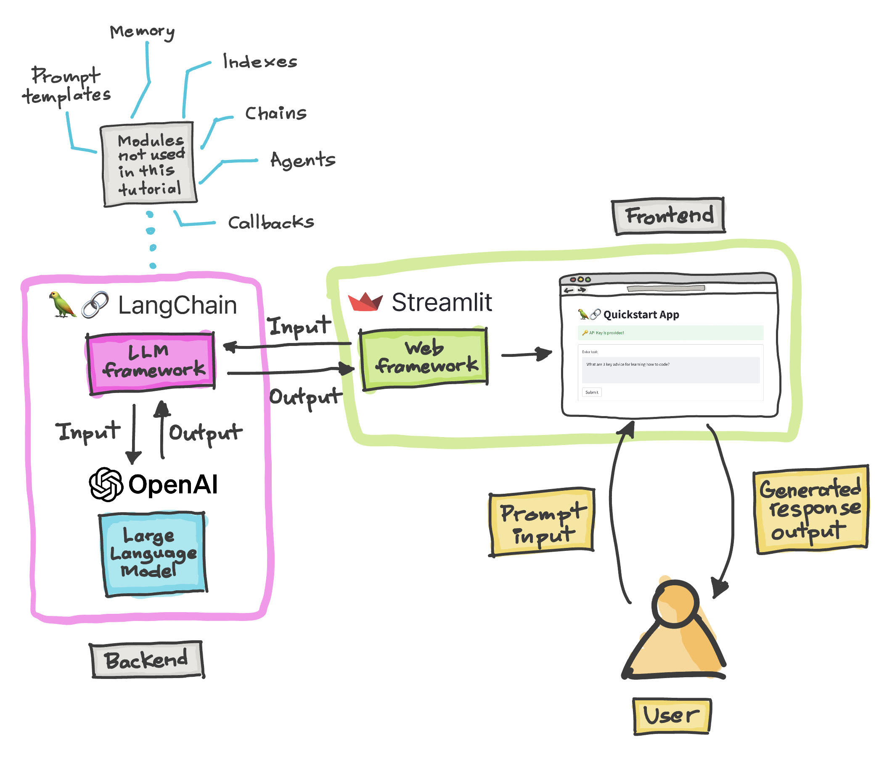

# 🦜🔗 Langchain - Quickstart App

<!-- repo-entrypoint-guide:start -->
## Repository guide

**Repository context:** This is a LangChain + Streamlit quickstart example, not a verified production AI service. Follow the original [Overview](#overview-of-the-app) and [Try out the app](#try-out-the-app) while checking the installed package versions.

**Privacy:** Never place an OpenAI API key in source code or an uploaded notebook. Review whether input text is sent to a hosted provider before testing with nonpublic data.

### Find your way

- [Overview of the App](#overview-of-the-app)
- [Demo App](#demo-app)
- [Get an OpenAI API key](#get-an-openai-api-key)
- [Try out the app](#try-out-the-app)
<!-- repo-entrypoint-guide:end -->

Build your first LLM powered app with Langchain and Streamlit.

## Overview of the App

- Accepts input text (*e.g.* `What are the three key pieces of advice for learning how to code?`) as prompt input using Streamlit's `st.text_area()`, then assign this to the `text` variable.
- LLM model is called via `llm()` and it is applied on the prompt input `text` to generate a response via `llm(text)`

## Demo App

## Get an OpenAI API key

You can get your own OpenAI API key by following the following instructions:
1. Go to https://platform.openai.com/account/api-keys.
2. Click on the `+ Create new secret key` button.
3. Next, enter an identifier name (optional) and click on the `Create secret key` button.

## Try out the app

Once the app is loaded, go ahead and enter your OpenAI API key and type a question in the text box and wait for a generated response.
